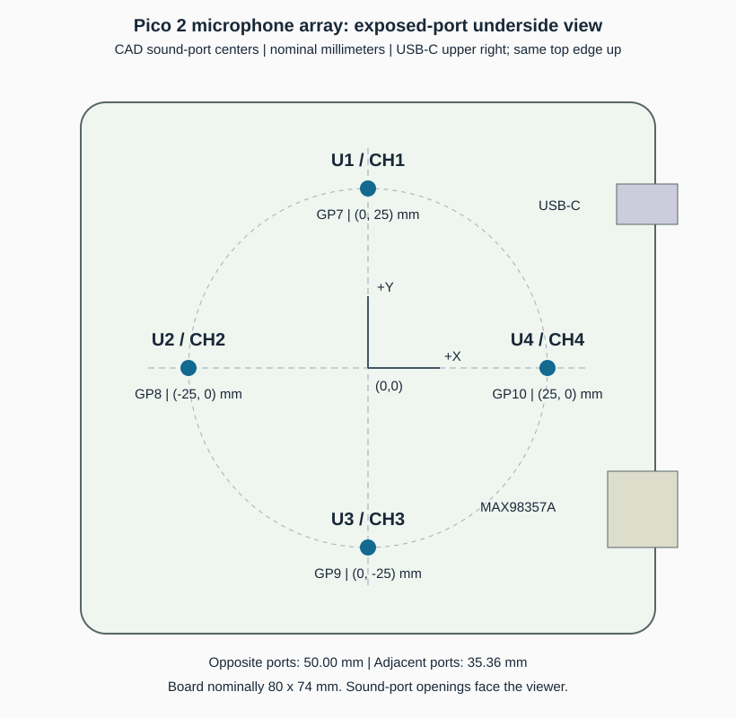

# Microphone array geometry, 2026-10-14



Coordinate frame: look directly at the exposed sound-port underside, keeping the same top edge up. USB-C is upper RIGHT and the MAX98357A module lower RIGHT. +X points right, +Y up, +Z toward the viewer. Origin is the board center. This is a left/right flip of the original component-side CAD frame: underside X = -CAD X, underside Y = CAD Y. All default JSON port coordinates and test position labels now use this exposed-port convention. Original CAD positions are preserved as `component_side_port_mm` and component origins remain in CAD mils.

## Channel map and acoustic-port centers

| Channel | Mic | Net | GPIO | CAD pin | Nominal X/Y, mm | Export-derived X/Y, mm |
|---|---|---|---|---|---|---|
| 1 | U1 | DATA1 | GP7 | 10 | (0, 25) | (-0.0001270, 25.0000059) |
| 2 | U2 | DATA2 | GP8 | 11 | (-25, 0) | (-25.0001888, -0.0001168) |
| 3 | U3 | DATA3 | GP9 | 12 | (0, -25) | (0.0006096, -24.9997900) |
| 4 | U4 | DATA4 | GP10 | 14 | (25, 0) | (24.9999932, -0.0001270) |

Use the nominal coordinates for the initial direction model. Sub-micrometer residuals in the export are CAD rounding, not measured placement accuracy. This is the design geometry, not a metrology measurement of assembled holes or acoustic phase centers. The user has confirmed four physical open sound-port holes.

## Extraction and checks

The `.epru` export was verified byte-for-byte against the member in the supplied `.epro2` archive. The reproducible extractor and JSON include source hash and source line references:

```powershell
python tools/extract_geometry.py
```

The PCB coordinates are stored in mils (1 mil = 0.0254 mm), despite the canvas display unit being mm. This is cross-checked against the MCU footprint 100-unit pad pitch (2.54 mm), the 3 x 4 mm microphone body outline, and the nominal 80 x 74 mm board outline.

For each mic, the acoustic center is footprint `POLY e3` on document layer 13, at local (-0.005, -31.89) mil. It coincides with `FILL e26`, the circular ground-ring clearance, and is distinct from the pin-one marking. This interpretation is consistent with the package/footprint drawings in [Infineon IM72D128 datasheet, figures 12 and 13](https://www.infineon.com/assets/row/public/documents/24/49/infineon-im72d128-datasheet-en.pdf). U1 uses a board-local footprint copy with the same port coordinates.

All four microphones are on the top layer; no bottom-side mirror transform is applied. The CAD port calculation is `position + R(angle) * local_port`; then X is negated for the exposed-port frame. The transformed pin-1 DATA pad was independently checked against a routed endpoint on the corresponding DATA net for all four mics, verifying rotation sign. PCB PAD_NET records then link DATA1..4 to U5 pins 10, 11, 12, and 14, which the schematic symbol maps to GP7, GP8, GP9, and GP10. Firmware captures GPIO7..10 in that order.

| Mic | Component origin X/Y, mil | Rotation |
|---|---|---|
| U1 | [0, 952.3622] | 180 degrees |
| U2 | [952.3694, 0.0004] | 90 degrees |
| U3 | [-0.019, -952.3537] | 0 degrees |
| U4 | [-1016.1417, 0] | 90 degrees |

Component origins alone yield the wrong spacing: the port has a roughly 0.81 mm offset along local Y. Applying that offset explains why U4 has a different origin radius while its sound port still lies on the 25 mm cross.

## Pair geometry and delay bounds

| Pair | Separation, mm | Maximum geometric delay, microseconds | Delay at 16 kHz, samples |
|---|---|---|---|
| CH1-CH2 | 35.3555 | 103.08 | 1.649 |
| CH1-CH3 | 49.9998 | 145.77 | 2.332 |
| CH1-CH4 | 35.3555 | 103.08 | 1.649 |
| CH2-CH3 | 35.3557 | 103.08 | 1.649 |
| CH2-CH4 | 50.0002 | 145.77 | 2.332 |
| CH3-CH4 | 35.3547 | 103.07 | 1.649 |

Delay bounds assume sound speed 343 m/s; adjust the model for temperature when needed. These short baselines need fractional-sample delay estimates for useful angular resolution. A coplanar array has above/below ambiguity; a first estimator should report in-plane azimuth with a stated hemisphere/source-plane assumption.

## Next physical validation

1. Keep the coordinate convention fixed and verify the expected channel response using a nearby controlled source at each port.
2. Compare relative sensitivity with a source approximately equidistant from the four ports, clear underside openings, and fixed geometry. Do not apply gain calibration from the earlier uncontrolled ambient capture.
3. For delay and direction tests, use broadband sound or a known sweep at documented positions. A steady 1 kHz tone is useful for level comparison but gives periodic correlation ambiguity and limited delay evidence. Compare measured delay signs and magnitudes against this geometry before reporting angles.

No firmware changes or hardware tests were performed during geometry extraction.
