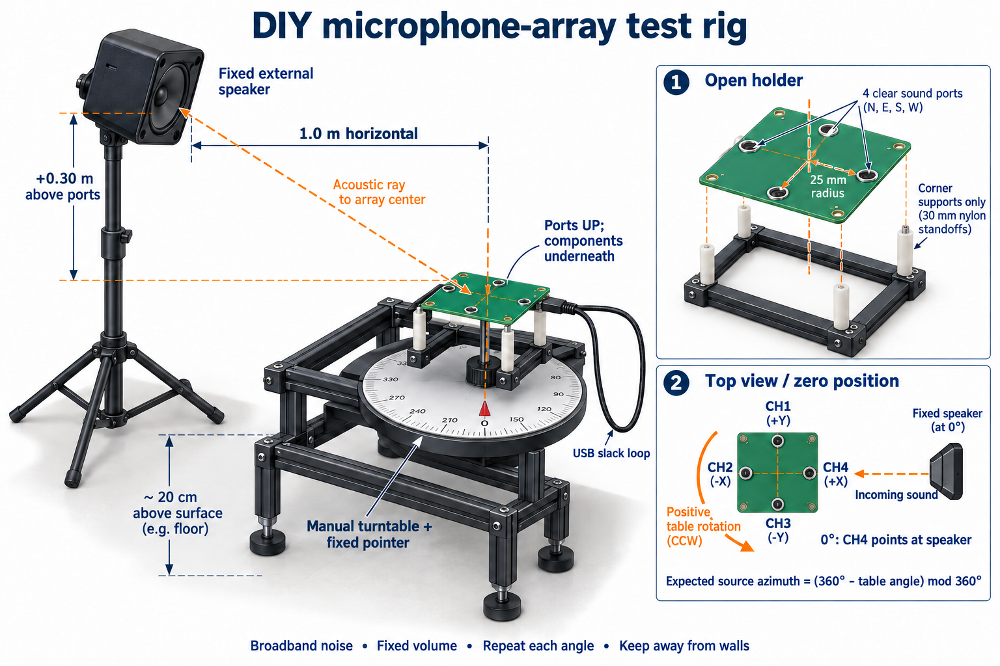

# Proposed acoustic test rig

Concept: an external fixed speaker and a horizontal exposed-port-up microphone
array rotating about its center on a manually indexed turntable. This is a
positioning fixture for repeatable comparisons, not an anechoic test system.

## Construction

- Use four existing PCB corner mounting holes and nonconductive standoffs on
  an open perimeter frame. PCB is nominally 80 x 74 mm. Confirm actual hole
  diameter and component clearance before choosing fasteners; do not clamp
  through microphone packages or press on components.
- Mount the frame on a manual turntable with a printed angle scale and fixed
  pointer. Rotation axis must intersect the array origin and be normal to
  the port plane. Keep ports facing upward and unobstructed, components below.
- Raise the PCB roughly 20 cm above nearby supporting surfaces where practical.
  Keep the immediate surroundings open; reflective surfaces still affect results.
- Provide a loose USB cable loop and strain relief on the holder. Reposition
  between measurements; do not wind the cable through multiple full rotations.
- Place an external speaker at approximately 1.0 m horizontal displacement
  from array center and 0.30 m above the port plane; aim its acoustic center
  toward the array center. Mark these distances and the source center.
  These are proposed setup dimensions, not existing measured geometry.

Use the external source rather than the deferred onboard passive-speaker path.
A ruler/tape, printed protractor, turntable bearing or indexed pivot, adjustable
speaker stand and an open board holder are sufficient for an initial rig.
A cardboard template can establish layout; the assembled holder should be rigid.

## Coordinate convention

In the exposed-port view, CH1 is +Y (top), CH2 -X (left), CH3 -Y (bottom),
CH4 +X (right). For the turntable zero, point +X/CH4 toward the speaker's
horizontal bearing. Label that position physically. Keep this convention when
viewing the now-horizontal PCB from above.

If table rotation is positive counterclockwise viewed from above the exposed
ports, expected source azimuth in the board frame is (360 - table angle) mod 360.
If the printed scale increases clockwise instead, document that and use the
opposite sign. The elevated source changes the in-plane direction magnitude,
not its horizontal azimuth. Proposed range is about 1.044 m; elevation about
16.7 degrees. Record actual coordinates rather than treating ruler placement
as exact acoustic ground truth.

## Initial validation procedure

1. Play reference-broadband.wav on repeat through the external speaker at
   fixed volume. Keep OS audio processing and output settings fixed.
2. Record three seconds at each table position in 30-degree steps. Let the
   fixture settle and keep hands away during recording. Repeat the sweep three
   times, preferably alternating rotation order.
3. Preserve WAVs, transport integrity, raw pair delays, rejected results,
   estimated azimuths and setup measurements. Record angle in filenames and
   a manifest; avoid relabeling results after seeing estimated angles.
4. Compare rejection rate, angular discrepancy against the approximate source
   direction, and repeatability. A reproducible offset is still not proof of
   intrinsic microphone phase mismatch; repeat with changed room placement
   before applying calibration.

Do not infer accurate angles from a small fitting residual alone. The existing
right/top recordings with impossible opposite-pair estimates remain regression
cases. This rig should help investigate such cases; it cannot eliminate room
reflections or guarantee angular accuracy.
